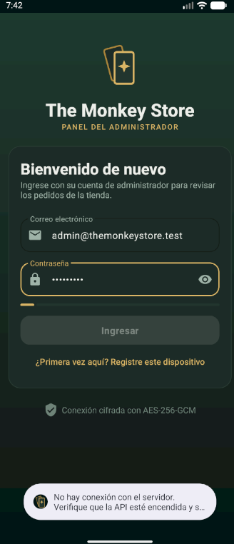
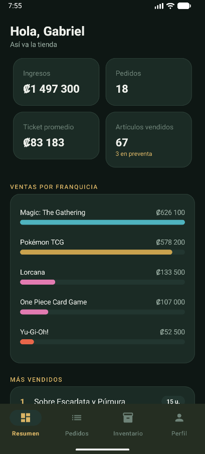
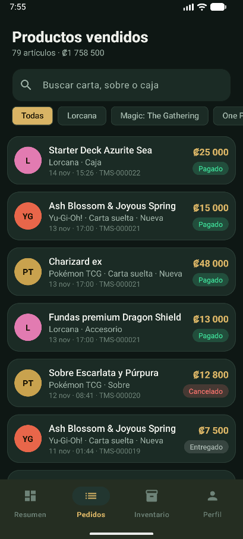
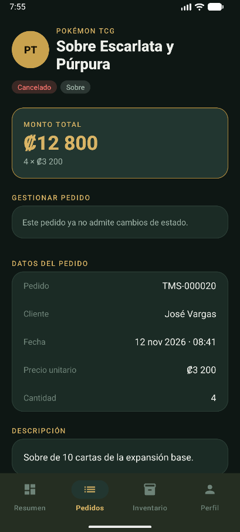
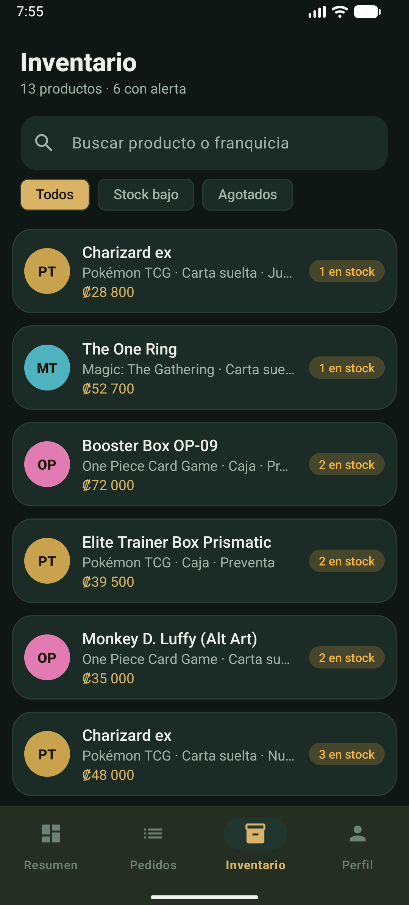
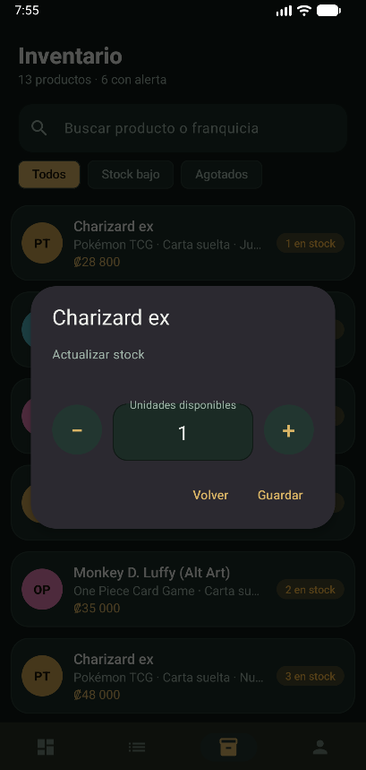
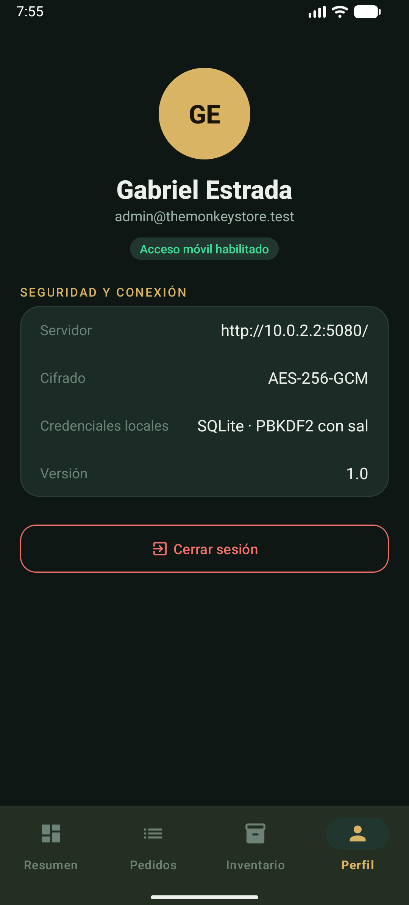
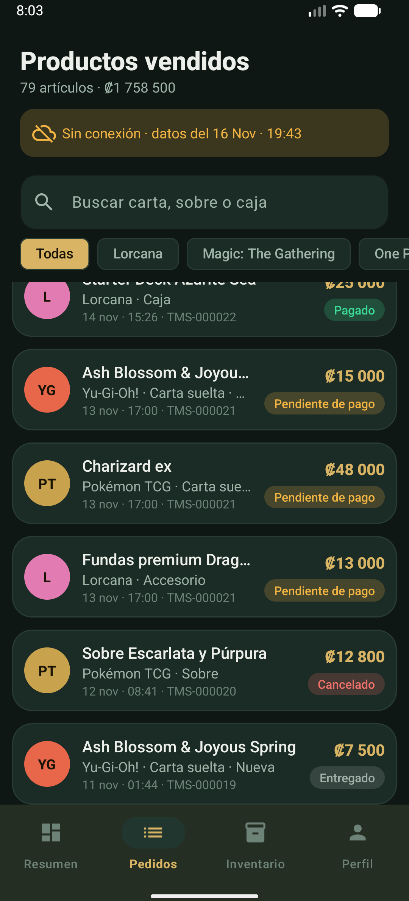
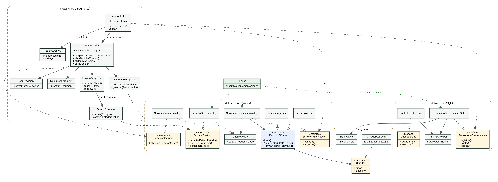
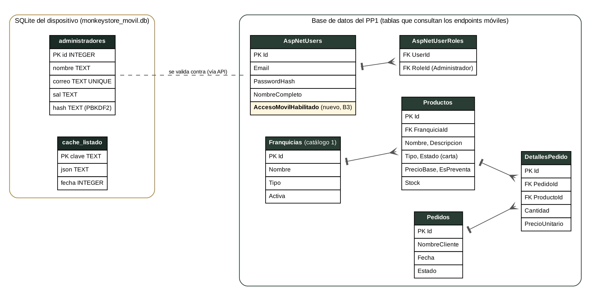

<div align="center">

# Monkey Store Admin

**Aplicación Android nativa para los administradores de The Monkey Store**

[](https://github.com/estrada703/proyecto-programado-2/actions/workflows/android.yml)


Proyecto Programado 2 · Universidad Hispanoamericana

</div>

---

The Monkey Store es la tienda de cartas coleccionables del Proyecto Programado 1 (sobres, cajas, cartas sueltas, accesorios y preventas de Pokémon TCG, Magic: The Gathering, Yu-Gi-Oh!, One Piece Card Game y Lorcana).
**Monkey Store Admin** lleva la administración de la tienda al teléfono: la aplicación no tiene base de datos propia del negocio, sino que consulta la **Web API del PP1**.

> La pantalla cambia; el dato y la regla se quedan donde estaban.

## Capturas

<table>
  <tr>
    <td align="center"><br><sub>Ingreso</sub></td>
    <td align="center"><br><sub>Resumen</sub></td>
    <td align="center"><br><sub>Productos vendidos</sub></td>
    <td align="center"><br><sub>Detalle y gestión</sub></td>
  </tr>
  <tr>
    <td align="center"><br><sub>Inventario</sub></td>
    <td align="center"><br><sub>Actualizar stock</sub></td>
    <td align="center"><br><sub>Perfil</sub></td>
    <td align="center"><br><sub>Sin conexión</sub></td>
  </tr>
</table>

## Funciones

| | Función |
|---|---|
| 🔐 | **Ingreso y registro** del administrador con credenciales cifradas; solo administradores con acceso móvil habilitado |
| 📊 | **Resumen**: ingresos, pedidos, ticket promedio, ventas por franquicia, más vendidos y pedidos por estado |
| 🃏 | **Productos vendidos o reservados** con filtro por franquicia y búsqueda por nombre en memoria |
| 🧾 | **Detalle** de cada producto y **gestión del estado del pedido** (pagado, enviado, entregado, cancelado) |
| 📦 | **Inventario** con alertas de stock bajo o agotado y edición de unidades |
| 📴 | **Modo sin conexión**: último listado guardado en SQLite (E1) |
| 📱 | **Dos paneles** en horizontal y tableta: listado y detalle lado a lado (E2) |
| ✅ | **26 pruebas unitarias** JUnit (E8) y **compilación automática** del APK en cada push (E9) |

## Tecnologías

| Capa | Tecnología |
|---|---|
| App móvil | Java 17 · Android (minSdk 24) · Material 3 · RecyclerView · Fragments |
| Red | Volley con una única `RequestQueue`, tiempo de espera y reintentos |
| Datos locales | SQLite (`SQLiteOpenHelper`), contraseñas con PBKDF2 + sal |
| Seguridad | AES-256-GCM: `Base64(IV ‖ cifrado ‖ etiqueta)`, IV aleatorio por mensaje |
| Web API | ASP.NET Core · Identity · Entity Framework Core · OpenAPI |
| CI | GitHub Actions: pruebas, APK de depuración, APK firmado y compilación de la API |

## Estructura

```
Android/                 proyecto de Android Studio
  app/src/main/java/cr/ac/monkeystore/movil/
    ui/                  activities, fragments y adaptadores
    datos/remoto/        servicios Volley contra la Web API
    datos/local/         SQLite: credenciales y caché
    seguridad/           cifrado AES-GCM y hash PBKDF2
    modelo/              entidades y reglas puras (probadas con JUnit)
Web/                     Web API y aplicación web (ASP.NET Core)
docs/                    capturas y diagramas
LEEME.md                 pasos detallados para ejecutar
local.properties.ejemplo claves que espera la app (clave AES de prueba)
```

## Endpoints móviles

| Método | Ruta | Descripción |
|---|---|---|
| `POST` | `/api/movil/validar` | ¿Las credenciales cifradas son de un administrador válido? |
| `POST` | `/api/movil/ingresar` | Ingreso; devuelve nombre y token de sesión |
| `GET` | `/api/movil/compras` | Productos comprados o reservados |
| `PUT` | `/api/movil/pedidos/{id}/estado` | Cambia el estado de un pedido |
| `GET` | `/api/movil/productos` | Inventario |
| `PUT` | `/api/movil/productos/{id}/stock` | Actualiza el stock |

Respuestas: **200** correcto · **400** mensaje alterado o datos inválidos · **401** credenciales o token inválidos · **403** sin acceso móvil · **404** no existe · **409** cambio de estado no permitido.
Los endpoints `GET` y `PUT` requieren `Authorization: Bearer <token>`.

## Inicio rápido

```bash
# 1. Web API
cd Web/TheMonkeyStore.Movil.Api
dotnet user-secrets set "Movil:ClaveAes" "MDEyMzQ1Njc4OWFiY2RlZjAxMjM0NTY3ODlhYmNkZWY="
dotnet run --launch-profile http          # http://localhost:5080

# 2. App Android
#    Copie local.properties.ejemplo como Android/local.properties,
#    abra la carpeta Android/ en Android Studio y ejecute en el emulador.
```

Desde el emulador la API se alcanza en `http://10.0.2.2:5080/`. Los pasos completos están en [LEEME.md](LEEME.md).

**Administradores de prueba**

| Correo | Contraseña | Acceso móvil |
|---|---|---|
| `admin@themonkeystore.test` | `Admin123!` | Habilitado |
| `admin.sinmovil@themonkeystore.test` | `Admin123!` | Deshabilitado |

> La clave AES de este repositorio es **solo de prueba**. El almacén de claves del APK y sus contraseñas no se suben al repositorio.

## Seguridad

1. La app arma `{correo, clave}` y lo cifra con **AES-256-GCM** usando una clave de 32 bytes que vive en `local.properties` (no se sube) y se lee con `BuildConfig`.
2. Envía `{ "datos": "Base64(IV ‖ cifrado ‖ etiqueta)" }`.
3. La API descifra con `System.Security.Cryptography.AesGcm` y la clave en *user secrets*. Si el mensaje fue alterado, la etiqueta no coincide y responde **400** sin revelar detalles.
4. En el teléfono, la contraseña se guarda como resumen **PBKDF2 con sal**, nunca en texto plano, y la bitácora nunca registra contraseñas.

## Arquitectura



Las pantallas dependen de **interfaces** (`ServicioAutenticacion`, `ServicioCompras`, `ServicioGestion`, `RepositorioCredenciales`, `Cifrador`); la clase `Fabrica` entrega las implementaciones concretas, y la clase abstracta `PeticionCifrada` comparte el cifrado y el envío entre el registro y el ingreso.



## Pruebas

```bash
cd Android
./gradlew testDebugUnitTest
```

Cubren el cifrado (ida y vuelta, IV distinto por mensaje, formato y mensaje alterado), el hash de contraseñas, el filtro y el parser del listado, el cálculo del resumen y las reglas de gestión de pedidos e inventario.

## Integrantes

- Lileana Guzmán González
- Gabriel Estrada Esquivel
